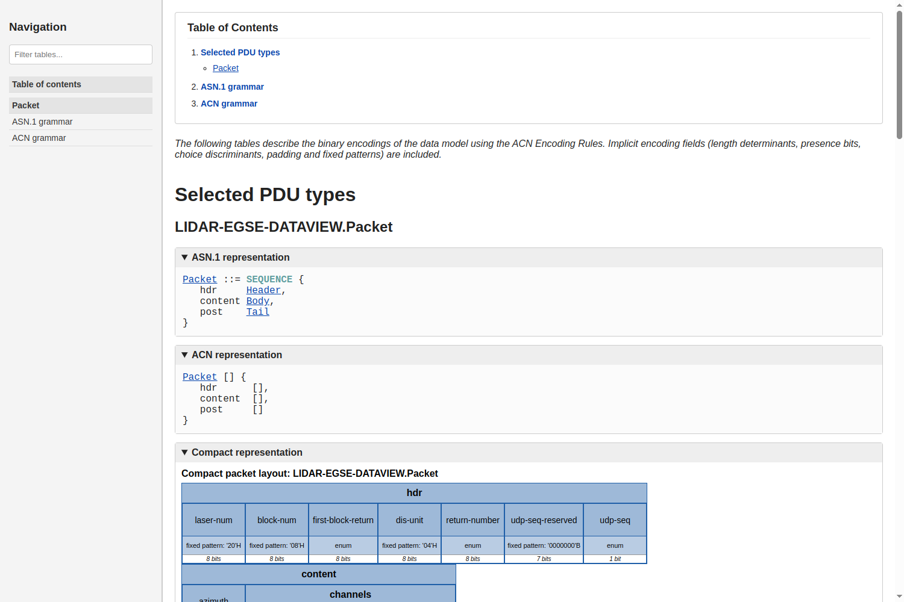
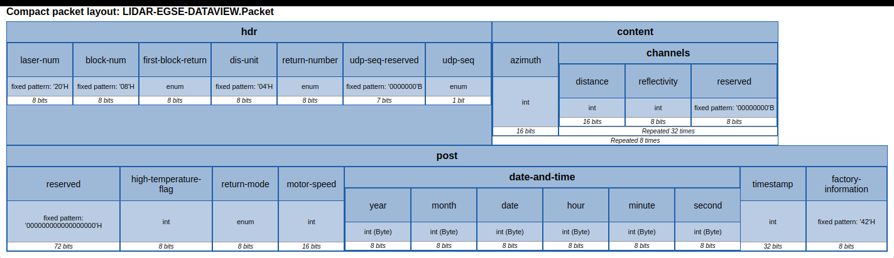
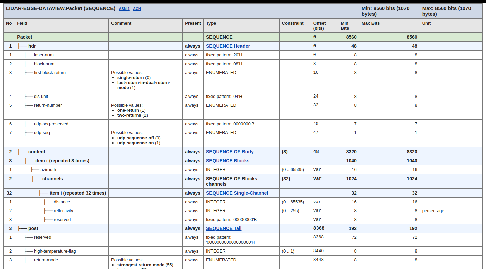
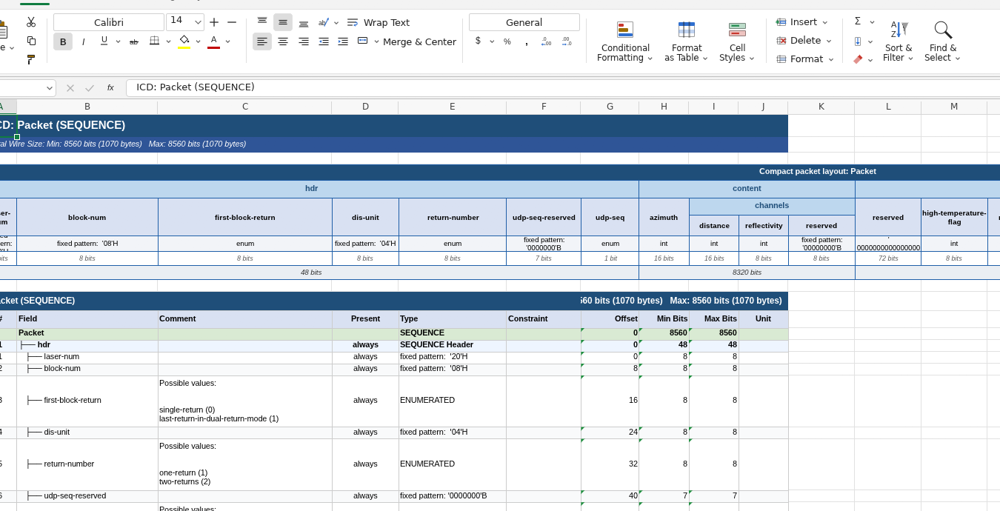

# ASN.1 / ACN ICD Generator

`icd-generator.py` is a documentation generation tool for ASN.1 and ACN data models compiled with `asn1scc`. It analyzes the concrete wire encoding of messages—including implicit encoding fields such as length determinants, presence flags, choice tags, padding, and fixed patterns—and generates bit-level Interface Control Documents (ICDs).

The tool supports two output backends:
- **Interactive HTML (`-t html`)**: A modern, responsive single-page application with sidebar filtering, table of contents, collapsible sections, clickable cross-references, bit-level detailed tables, and compact horizontal packet layout diagrams.
- **Excel Spreadsheet (`-t excel`)**: A multi-tab Microsoft Excel (`.xlsx`) workbook containing dedicated worksheets for each root Protocol Data Unit (PDU) and a consolidated `Constants` sheet, featuring formatted compact block layouts, color-coded section headers, and auto-sized columns.

---

## Table of Contents

1. [Overview](#overview)
2. [Command-Line Usage](#command-line-usage)
3. [Architecture and Operation](#architecture-and-operation)
4. [Key Features](#key-features)
   - [Compact Packet Layout](#compact-packet-layout)
   - [Detailed Field Tables](#detailed-field-tables)
   - [Implicit Encoding Fields](#implicit-encoding-fields)
   - [ASN.1 Constants Reporting](#asn1-constants-reporting)
   - [Anchor Navigation and Browser History](#anchor-navigation-and-browser-history)
5. [Lidar EGSE Case Study](#lidar-egse-case-study)
   - [ASN.1 and ACN Data Model](#asn1-and-acn-data-model)
   - [HTML Output Extracts](#html-output-extracts)
   - [Excel Output Extracts (GridCraft)](#excel-output-extracts-gridcraft)
   - [Binary Layout Analysis](#binary-layout-analysis)
6. [Prerequisites and Dependencies](#prerequisites-and-dependencies)

---

## Overview

In mission-critical and space systems, Protocol Data Units (PDUs) are frequently defined using ASN.1 with ACN (ASN.1 Control Notation) to specify bit-level encodings, fixed sync patterns, endianness, and variable-length array determinants. Verifying and communicating these binary packet formats across engineering teams requires clear Interface Control Documents that detail:

- Exact bit offsets and field sizes (both minimum and maximum).
- Binary field types and value constraints.
- Implicit wire fields injected by encoding rules (e.g. presence bits, length determinants, alignment bits).
- Enumerated value mappings and fixed constant definitions.

`icd-generator.py` automates the generation of these documents directly from source ASN.1 and ACN definitions.

```
┌─────────────────────┐       ┌─────────────────────┐
│  ASN.1 Model Files  │       │   ACN Layout Files  │
└──────────┬──────────┘       └──────────┬──────────┘
           │                             │
           └──────────────┬──────────────┘
                          │
                          ▼
               ┌──────────────────────┐
               │       asn1scc        │  (Calls asn1scc -icd <tmp.json>)
               └──────────┬───────────┘
                          │
                          ▼
               ┌──────────────────────┐
               │   icd-generator.py   │  Parses AST, layout trees, constants
               └──────────┬───────────┘
                          │
             ┌────────────┴────────────┐
             ▼                         ▼
   ┌──────────────────┐      ┌──────────────────┐
   │ Interactive HTML │      │   Excel (.xlsx)  │
   │  Documentation   │      │     Workbook     │
   └──────────────────┘      └──────────────────┘
```

---

## Command-Line Usage

The generator is located in `contrib/icd-generator.py`.

### Synopsis

```bash
python3 contrib/icd-generator.py [-h] [-o OUTPUT] [-t {html,excel}] [--root ROOT] [--dump-json DUMP_JSON] <asn1_file> [<acn_file> ...]
```

### Options

| Flag | Default | Description |
|------|---------|-------------|
| `-o, --output` | `icd.html` (or `icd.xlsx`) | Path of the generated output file. |
| `-t, --type` | `html` | Output backend: `html` for interactive HTML or `excel` for an Excel workbook (`.xlsx`). |
| `--root` | None (all PDUs) | Filter to generate documentation only for specified root PDU type name(s). |
| `--dump-json` | None | Save the intermediate JSON emitted by `asn1scc -icd` to a file for debugging or testing. |
| `-h, --help` | | Display help message and exit. |

### Examples

Generate HTML documentation for a complete model:
```bash
python3 contrib/icd-generator.py -o build/lidar.html contrib/icd-test/lidar.asn contrib/icd-test/lidar.acn
```

Generate an Excel workbook:
```bash
python3 contrib/icd-generator.py -t excel -o build/lidar.xlsx contrib/icd-test/lidar.asn contrib/icd-test/lidar.acn
```

Generate documentation for a single root PDU:
```bash
python3 contrib/icd-generator.py --root Packet -o packet-icd.html model.asn model.acn
```

---

## Architecture and Operation

1. **Compilation Phase**:
   `icd-generator.py` invokes the `asn1scc` compiler with the `-icd <temp_json>` flag. During this step, `asn1scc` computes exact layout ranges, bit offsets, sizes, determinants, comments, and AST metadata.
2. **Intermediate Representation (IR) Processing**:
   The Python script parses the generated JSON representation into structured objects:
   - **AST Types**: Sequence, Choice, Sequence Of, Enumerated, Integer, Octet String, etc.
   - **Fields**: Path, component names, bit offsets, min/max bit lengths, present conditions, comments, and unit annotations.
   - **Constants**: Top-level ASN.1 constant definitions, evaluated types, and textual representations.
3. **Rendering Phase**:
   - For **HTML**, it generates an HTML5 page with embedded CSS, client-side search filtering, collapsible `<details>` blocks, and deep linking anchors.
   - For **Excel**, it uses `openpyxl` to build an multi-sheet workbook, formatting cell fonts, borders, fills, and column widths.

---

## Key Features

### Compact Packet Layout

Both backends include a horizontal diagram showing the sequence of packet fields on the wire.

- **Hierarchical Nesting**: Nested sequence fields appear grouped under their parent field header.
- **Array (`SEQUENCE OF`) Representation**: Instead of displaying only an opaque `SEQUENCE OF` block or appending a redundant multiplier (`<name> x N`) to the title, the compact layout shows the component name, nests the inner element structure, and displays a clean footer band indicating `"Repeated N times"`.
- **Concise Type Badges**: Field types are rendered using concise keywords: `int`, `bool`, `enum`, `fixed pattern`, etc.

### Detailed Field Tables

The detailed table provides an exhaustive listing of every element in the packet:

| Column | Description |
|--------|-------------|
| **No** | Field index within the container. |
| **Field** | Indented tree representation showing the structural hierarchy (`├── field`). |
| **Comment** | Comments extracted from ASN.1/ACN source, plus enumerated value listings (`name (value)`). |
| **Present** | Presence condition (e.g. `always` or conditional presence expression). |
| **Type** | Concrete ASN.1/ACN type (with hyperlinks to definitions in HTML mode). |
| **Constraint** | Value range constraints (e.g. `0 .. 65535`, size constraints). |
| **Offset (bits)** | Exact bit offset from packet start (or `var` for dynamic/repeated fields). |
| **Min Bits / Max Bits** | Minimum and maximum bit length occupied on the wire. |
| **Unit** | Physical unit metadata extracted from ASN.1 comments (e.g. `--{ us }--`, `--{ percentage }--`). |

### Implicit Encoding Fields

Encoding rules often inject wire fields that do not exist directly in the application ASN.1 definition:
- Length determinants (e.g. `N`) for variable-size sequences or octet strings.
- Presence flags for `OPTIONAL` sequence components.
- Choice discriminants / selection tags.
- Fixed pattern sync words and padding/reserved bits.

When multiple implicit fields share default names (such as multiple nested length determinants `N`), `icd-generator.py` automatically disambiguates them sequentially (`N`, `N1`, `N2`) unless explicitly overridden in ACN.

### ASN.1 Constants Reporting

When constants are declared in ASN.1 modules (e.g. `max-elements INTEGER ::= 32`), they are collected into a dedicated **Constants** table:
- In HTML: Accessible directly via the Table of Contents at the top of the page.
- In Excel: Placed in a separate `Constants` tab.

### Anchor Navigation and Browser History

The HTML backend is designed for intuitive exploration of complex multi-packet ICDs:
- **Table of Contents**: Placed at the top with hyperlinks to:
  1. Selected PDU types
  2. Constants table (when constants are defined)
  3. Original ASN.1 grammar dump
  4. Original ACN grammar dump
- **Bidirectional Anchors**: Clicking any type reference jumps to its detailed section or grammar definition. Target anchors are placed so that clicking the browser **Back** button returns the user directly to their previous view without losing scroll position.
- **Instant Search/Filter**: A search box in the sidebar filters tables dynamically as you type.

---

## Lidar EGSE Case Study

The `contrib/icd-test` directory provides a real-world test case based on a Lidar Electrical Ground Support Equipment (EGSE) packet definition.

### ASN.1 and ACN Data Model

The `Packet` type contains a header, a repeating payload of sensor channels, and a post-amble tail:

```asn1
Packet ::= SEQUENCE {
   hdr     Header,
   content Body,
   post    Tail
}

Header ::= SEQUENCE {
   first-block-return ENUMERATED {single-return, last-return-in-dual-return-mode},
   return-number      ENUMERATED {one-return(1), two-returns(2)},
   udp-seq            ENUMERATED {udp-sequence-off, udp-sequence-on}
}

Body ::= SEQUENCE (SIZE (8)) OF Blocks

Blocks ::= SEQUENCE {
   azimuth  INTEGER (0..65535),
   channels SEQUENCE (SIZE (32)) OF Single-Channel
}

Single-Channel ::= SEQUENCE {
   distance     INTEGER (0..65535),
   reflectivity INTEGER (0..255)  --{ percentage }--
}
```

The corresponding ACN definition injects fixed sync markers, specifies little-endian encodings, and inserts alignment patterns:

```acn
Header[] {
   laser-num         NULL [size 8, pattern '20'H],
   block-num         NULL [size 8, pattern '08'H],
   first-block-return     [size 8, encoding pos-int],
   dis-unit          NULL [size 8, pattern '04'H],
   return-number          [size 8, encoding pos-int, encode-values],
   udp-seq-reserved  NULL [size 7, pattern '0000000'B],
   udp-seq           []
}

Blocks [] {
   azimuth  [size 16, endianness little, encoding pos-int],
   channels []
}

Single-Channel [] {
   distance     [size 16, endianness little, encoding pos-int],
   reflectivity [],
   reserved     NULL [size 8, pattern '00000000'B]
}
```

---

### HTML Output Extracts

#### Interface Overview and Navigation

The generated HTML document contains a sidebar filter, Table of Contents, and collapsible views:



#### Compact Packet Layout

The compact layout for `Packet` illustrates how arrays are displayed: the `content` block contains `azimuth` and the repeated `channels` group, with "Repeated 32 times" and "Repeated 8 times" markers:



#### Detailed Field Table

The detailed table provides precise bit offsets, constraints, and units (e.g. `percentage`, `us`):



---

### Excel Output Extracts (GridCraft)

The Excel backend produces a formatted `.xlsx` workbook. The screenshots below show the generated `lidar.xlsx` opened in **GridCraft**:

#### Full GridCraft Workbook View


#### Zoomed Worksheet View

The top rows present the merged compact layout diagram, followed immediately by the formatted data table with column headers, tree-structured field names, and aligned numeric data:



---

### Binary Layout Analysis

From the generated ICD, the binary budget of the `Packet` structure is calculated as follows:

| Section | Content | Bit Length | Byte Length |
|---------|---------|------------|-------------|
| **`hdr`** | Sync bytes (`20`H, `08`H, `04`H), return flags, sequence bit | 48 bits | 6 bytes |
| **`content`** | 8 `Blocks`: <br/> • `azimuth`: 16 bits <br/> • 32 `Single-Channel` entries: 32 × (16-bit distance + 8-bit reflectivity + 8-bit reserved = 32 bits) = 1,024 bits <br/> Total per block = 1,040 bits (130 bytes) <br/> 8 blocks = 8 × 1,040 bits | 8,320 bits | 1,040 bytes |
| **`post`** | 72-bit reserved padding + 8-bit temp flag + 8-bit return mode + 16-bit motor speed + 48-bit timestamp date/time + 32-bit timestamp + 8-bit factory marker | 192 bits | 24 bytes |
| **Total** | **LIDAR-EGSE-DATAVIEW.Packet** | **8,560 bits** | **1,070 bytes** |

---

## Prerequisites and Dependencies

### Required Environment

- **Python**: Version 3.8 or later.
- **asn1scc**: The compiler binary is required to parse the ASN.1/ACN models and generate the internal layout JSON.
  - When installed via the release tarball, `icd-generator.py` is included directly alongside the `asn1scc` binary and locates it automatically.
  - Otherwise, ensure `asn1scc` is in your `PATH` or set the `ASN1SCC` environment variable pointing to the executable.

### Python Dependencies (pip)

The tool relies on the following Python package:

| Package | Purpose | Installation |
|---------|---------|--------------|
| **`openpyxl`** | Excel workbook generation (`.xlsx`), formatting, and styles | `pip install openpyxl` |

To install all dependencies:
```bash
pip install openpyxl
```

### Automatic Startup Dependency Verification

When `icd-generator.py` is executed, it automatically verifies at startup that all required Python dependencies are present. If a dependency is missing, the tool prints an error message specifying the exact `pip` command to install it:

```text
[-] Error: Missing required Python dependency:
[-]   - openpyxl
[-] Please install missing dependencies using pip:
[-]     pip install openpyxl
```

### Optional Tools

- **Spreadsheet Viewer**: [GridCraft](https://github.com/storyteller/gridcraft), LibreOffice Calc, or Microsoft Excel to inspect and edit generated `.xlsx` workbooks.
